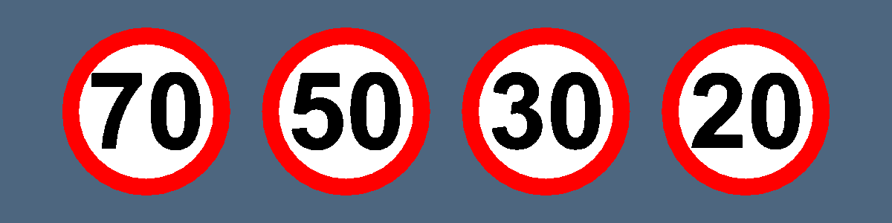
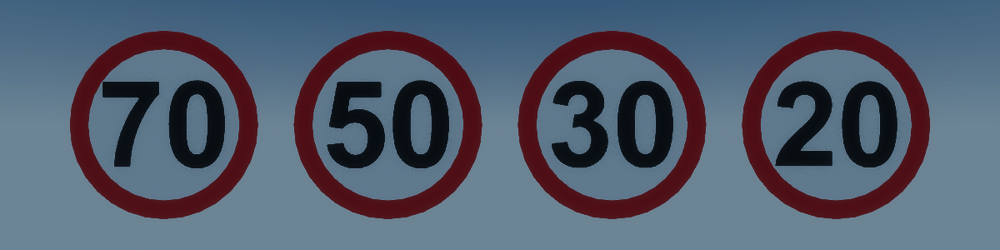

# Beta 8 verification

Issues: #5–#11. Candidate checks are recorded below; release installation is recorded once the packaged beta has passed.

- Reproduced the fallback county camper failure with active traffic: a kinematic traffic car reached approximately 3,326 m/s and launched the camper to 654 m/s. The same traffic test after the handback fix ran for 200 simulated seconds, travelled 1,989 m, peaked at 20.91 m/s, and stayed within 0.315 m of its normal road support height. The no-traffic comparison completed 4,040 m without a launch.
- Reproduced the Inverness worker exception against the retained prepared road model. The stack ended at `sign_metadata.contexts`, indexing an empty Shapely LineString. Boundary-crossing and outside-UK regression cases now pass.
- Full Inverness loading now reaches the ready state. Public map requests returned data for New York (3,047 ways), Berlin (1,520 ways) and Sydney (2,755 ways) through the added regional/global fallbacks. Their responses also pass the game converter: 1,722, 1,123 and 1,544 drivable segments respectively. The converter now consistently excludes pedestrian-only highways; 9,632 transport-control checks pass. Availability is external and cannot be guaranteed.
- The worker suite passed 50 tests, with one optional test skipped. The packaged Mac worker passed authenticated session, denied anonymous/origin/Host/traversal, and recovery-token rotation checks.
- HD close-up sign rendering remains legible after forcing UI font-atlas rebuilds; the sign masters retain their own atlas and glyph coordinates. Standard and HD rendering both pass the forced font-atlas rebuild check. Inverness and Barna both complete their real world-loading paths. The exact Mac archive passes deep signature verification and the launcher configuration probe. Both Standard/HD gameplay assemblies are identical within each platform. Standard native startup passes in 32.6 seconds to ready. The full live Cardiff menu test passes 17 checks, including invalid-selection rejection, search, immediate preview, preparation, selected-region reload and normal keyboard driving without damage. Its supplemental 180 m surface test stops because the loaded urban roads contain no single road longer than the fixture’s required 230 m; that longer traversal is not claimed. HD native startup also passes in 43.8 seconds to ready. The owner installation was updated through the production signature/hash-verifying installer; the existing beta-save hash is unchanged, and the installed chooser passes its Standard/HD configuration probe. Website build, type and link checks and all 11 website tests pass. Required PR source/worker checks and both native Windows helper and packaged-worker checks pass. The exact Windows game ZIP test awaits publication: its read-only CI token cannot retrieve an unpublished draft.

Logs and cached geographic fixtures remain local. Raw player logs and career files are not published. Windows driving and physical-controller checks require Windows hardware.

The actual importer also accepts 4,499, 4,500, 4,501, 9,999 and 10,000 synthetic road segments, and rejects 10,001 with the bounded area-size error. These boundary fixtures exercise parsing/preparation; they are not a driving-performance benchmark.

Public merge and release promotion require owner approval; the current signed release catalogue is staged locally at sequence 2026111606. The live feed stays on beta 7 until promotion.
